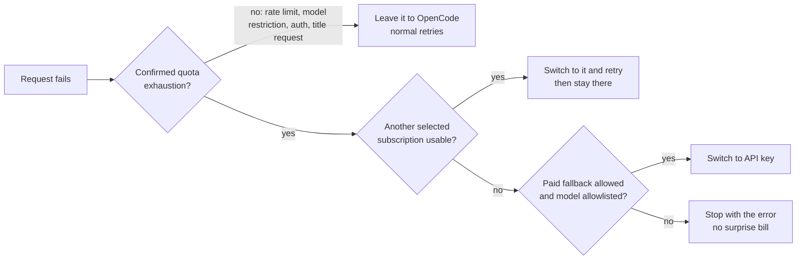

<div align="center">

# Zenox Account Router

**Never get stopped by a usage limit again.**
Sticky, quota-aware account failover for [OpenCode V2](https://opencode.ai) — your Claude and ChatGPT subscriptions first, an optional paid API key last.

[](https://www.npmjs.com/package/zenox-account-router)
[](https://github.com/CyberBoyAyush/zenox-account-router/actions/workflows/ci.yml)
[](./LICENSE)


</div>

---

You already have several accounts connected in OpenCode — say two Claude subscriptions and an Anthropic API key. OpenCode uses **one** of them at a time, and when its five-hour or weekly allowance runs out, your session just stops.

**Zenox Account Router** keeps you working:

```text
Claude account A ──(weekly limit reached)──▶ Claude account B ──(also exhausted)──▶ API key (only if you allow it)
```

- **Sticky by default.** It stays on the account you're using so prompt caches keep working. It only switches when an account is *confirmed* out of quota — never because another account "looks better".
- **Real quota detection.** Distinguishes true subscription exhaustion from temporary rate limits, model/plan restrictions and background-request errors. Only the first triggers a switch.
- **Paid fallback is opt-in.** Your API key is used only when *every* selected subscription is exhausted, you explicitly allowed billing, and the model is on your allowlist.
- **Both providers.** Anthropic (Claude Pro/Max/Team) and OpenAI (ChatGPT Plus/Pro/Team via Codex), each with its own usage reader and error classifier.
- **Zero credential handling of its own.** It works with the accounts already saved in OpenCode. Your existing auth plugins keep doing sign-in and token refresh; nothing secret is ever written to disk.

> Part of the **Zenox** family of OpenCode plugins. Works alongside [`zenox`](https://www.npmjs.com/package/zenox) and [`@ex-machina/opencode-anthropic-auth`](https://www.npmjs.com/package/@ex-machina/opencode-anthropic-auth).

## Quick start

**1. Connect your accounts in OpenCode** (if you haven't already):

```text
/connect   → Anthropic → Claude Pro/Max  (repeat for each account)
/connect   → OpenAI    → Sign in with ChatGPT
```

**2. Run the setup wizard:**

```sh
npx zenox-account-router setup
```

The wizard walks you through:

| Step | What you choose |
| --- | --- |
| Providers | Anthropic, OpenAI, or both |
| Accounts | Which saved subscription accounts take part in routing |
| Favorite | The preferred account when a fresh choice is needed (or automatic) |
| Paid fallback | Optional API key, explicit billing consent, and an exact model allowlist |
| Polling | How often to check usage (default 10 minutes, only while you're active) |
| Install | Adds the plugin to your global `opencode.json` after your auth plugins, with a private backup |

Nothing is written until you confirm the summary. Cancel at any point and no files change.

**3. Use OpenCode normally.** Check the router any time with:

```text
/router-status
```

## How it decides



1. **Keep the active account.** If one of your selected accounts is active and healthy, it stays active — even if another account has more allowance left, and even if your favorite is free again. No timer-based rebalancing.
2. **Initial choice.** Only when a choice is actually needed: your favorite if eligible, otherwise an account whose five-hour window is already running, then the one with the most weekly allowance left.
3. **Attribute failures precisely.** The router matches each rejected request to the exact account that sent it (token, and ChatGPT workspace for OpenAI). If it can't be sure, it does nothing.
4. **Switch once, retry once.** Concurrent sessions hitting the same limit cause a single switch. Accounts aren't revisited in a loop.
5. **Never replay output.** A response that already started streaming is never re-sent to another account.

If you manually pick an account that isn't in your selection, the router steps aside completely until you switch back.

## Commands

```sh
npx zenox-account-router setup              # interactive onboarding
npx zenox-account-router accounts           # list accounts saved in OpenCode (no secrets)
npx zenox-account-router status             # saved usage and router state (offline)
npx zenox-account-router status --refresh   # fetch live usage now (respects polling limits)
npx zenox-account-router dry-run --refresh  # which account would be chosen (never activates)
```

All commands accept `--json`, `--config <path>`, and `--server <url>`. Inside OpenCode, `/router-status` shows the live view.

## Configuration

Setup writes a small preferences file (no credentials):

```jsonc
// ~/.config/opencode/account-router.json
{
  "version": 1,
  "pollIntervalMs": 600000,
  "idleTimeoutMs": 600000,
  "providers": {
    "anthropic": {
      "accountIDs": ["cred_personal", "cred_work"],
      "favoriteAccountID": "cred_personal",
      "apiKeyAccountID": "cred_api_key",
      "allowPaidFallback": true,
      "apiKeyModels": ["claude-sonnet-5-5"]
    }
  }
}
```

and registers the plugin in your global OpenCode config:

```jsonc
// ~/.config/opencode/opencode.json
{
  "plugins": [
    "@ex-machina/opencode-anthropic-auth@next",
    "zenox-account-router"
  ]
}
```

Keep the router **after** your auth plugins. After editing preferences, run `/reload` in OpenCode.

## Usage monitoring

The router reads each selected account's subscription usage (five-hour and weekly windows, reset times) directly from Anthropic and OpenAI, the same endpoints Claude Code and Codex use:

- About once every **10 minutes while you're active**, never per message, and not at all when idle.
- Backs off automatically on errors and `Retry-After`.
- Usage never triggers a switch on its own — only a confirmed quota error from a real request does.

## Privacy & safety

- **No secrets on disk.** Preferences and state contain only account IDs, labels, usage percentages and cooldown times. Files are created `0600`; symlinked paths are refused.
- **OpenCode owns your tokens.** Credentials are read through OpenCode's plugin API, only for the accounts you selected. Refresh tokens are dropped immediately; the router never calls a token endpoint itself.
- **Bounded network use.** Only fixed provider usage URLs are contacted, redirects are refused, response sizes and timeouts are capped.
- **No inference, no hidden spending.** Setup, status, monitoring and dry-run never send a model request. Paid fallback requires explicit consent plus an exact model allowlist.

## Good to know

- **Account switches are global per provider** (that's how OpenCode works): switching affects every open session using that provider, and an activated paid key may also serve other concurrent sessions.
- **Managed providers use HTTP instead of WebSockets** so failures can be attributed reliably. OpenAI loses WebSocket connection reuse for routed sessions.
- **Usage endpoints are undocumented** provider APIs and may change; when parsing fails, usage shows as unknown — never as zero, and never as permission to spend.
- Designed for **one OpenCode service at a time**; separate OpenCode processes don't coordinate switches.

## Requirements

- OpenCode **V2 2.2.5 or newer**
- Node.js **22+** (for the `npx` CLI)
- Subscription sign-in for each account, e.g. via [`@ex-machina/opencode-anthropic-auth`](https://www.npmjs.com/package/@ex-machina/opencode-anthropic-auth) for Claude and OpenCode's built-in ChatGPT sign-in for OpenAI

## Development

```sh
pnpm install
pnpm check            # typecheck + lint + tests + build
pnpm test:coverage
```

The test suite (350+ tests) includes:

- **Unit and integration tests** for the usage readers, quota classifiers, policy, controller, onboarding and CLI.
- **End-to-end tests against the real OpenCode engine** (embedded `@opencode/sdk`, in-memory database, fake accounts, all network intercepted) covering failover, throttling, paid fallback, concurrency, token refresh and stream safety for both providers.
- **Property-based fuzzing** with fast-check for parsers, classifiers and random multi-session event sequences.

Design notes and verification details: [`docs/implementation.md`](./docs/implementation.md).

## License

[MIT](./LICENSE) © Ayush Sharma
